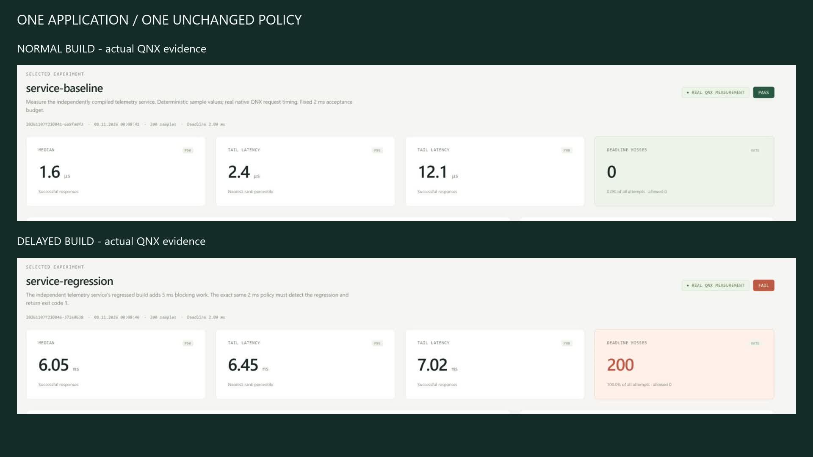

# PulseProof RT

Repeatable timing and regression checks for QNX 8.0 applications.

PulseProof RT combines a native C agent with a local Python workbench. Run a versioned scenario on QNX, evaluate its acceptance policy, and retain the samples behind the result. The CLI returns the same PASS/FAIL decision shown in the browser.

## An application regression under one policy

The [telemetry example](examples/telemetry-service/) is an independent QNX executable. One build adds a controlled 5 ms delay to its request path. Both builds use the same probe, workload and 2 ms policy:

| Recorded QNX result | Normal build | Delayed build |
| --- | ---: | ---: |
| Successful p99 | 12.052 µs | 7.017526 ms |
| Completed deadline misses | 0 | 200 |
| Verdict | PASS | FAIL |



`python -m pulseproof app-demo` measures both builds and returns exit **1** when the regression is detected. The [raw evidence](examples/rc/README.md) includes the two application hashes and original samples. Payload values are deterministic fixtures; timings are actual QNX observations.

## Quick start

Target acquisition is verified on Windows 11 x64 with QNX SDP 8.0, VMware Workstation, Windows OpenSSH and Python 3.10+. Set `QNX_SDP` to your licensed SDK directory. From the source checkout:

```powershell
python -m pulseproof build
.\scripts\Setup-Target.ps1
python -m pulseproof target status
python -m pulseproof target hello
python -m pulseproof run scenarios/timer-baseline.json
python -m pulseproof serve
```

Open [127.0.0.1:8765](http://127.0.0.1:8765/) to run scenarios and inspect history. [Setup](docs/SETUP.md) covers prerequisites, the SDK environment, target image and SSH pinning. The [tutorial](docs/TUTORIAL.md) walks through normal, loaded and failing experiments.

The running host application uses the Python standard library and local HTML/CSS/JavaScript, with no database, cloud service, npm package or telemetry. Node is used only for the optional JavaScript syntax check. Native executables run on QNX, not on the development host.

## Measurements and evidence

- Absolute monotonic timer releases, with separate wake lateness and release-to-completion response time.
- Native inter-process `ChannelCreate`, `MsgSend`, `MsgReceive`, `MsgReply` and `TimerTimeout` experiments.
- Bounded CPU pressure and guest CPU estimates from verified idle-thread execution clocks.
- Expected timeout counts and successful recovery exchanges checked independently.
- Nearest-rank p50/p95/p99, deadline policies and compatible history comparisons.
- JSON, CSV, raw NDJSON and standalone HTML reports with source/binary/scenario hashes.

Each run produces `artifacts/runs/<id>/`. Incomplete acquisition does not become a completed history entry. A timeout has an unobserved completion deadline; its error-return duration is not a successful service latency.

| Scenario | Purpose |
| --- | --- |
| `timer-baseline` / `timer-loaded` | Periodic work, without and with CPU pressure |
| `ipc-baseline` / `ipc-recovery` | Native request/reply, including four expected timeout/recovery pairs |
| `deadline-violation` | Deliberately fails an unchanged deadline |
| `service-baseline` / `service-regression` | Independent application's normal and delayed builds under one policy |

```powershell
python -m pulseproof app-demo
# Expected 1: the delayed application fails its policy.
python -m pulseproof compare examples/rc/service-baseline/summary.json examples/rc/service-regression/summary.json
# Expected 1: offline comparison of retained actual measurements.
```

Exit **0** accepts a policy, **1** rejects it, and **2** indicates invalid input or acquisition failure. A failed reference baseline also makes `app-demo` return 2.

## Relationship to QNX profiling tools

PulseProof provides a versioned acceptance experiment and an evidence-backed build decision. QNX [System Profiler](https://qnx.com/developers/docs/8.0/com.qnx.doc.ide.userguide/topic/sysprof_editor.html) investigates kernel events and thread interactions; [Application Profiler](https://www.qnx.com/developers/docs/8.0/com.qnx.doc.ide.userguide/topic/appprofiler_tool.html) helps locate application costs. Use those tools to explain a reproduced regression. PulseProof does not replace tracing, parse `.kev` files, or establish a worst-case timing bound.

The integration is explicit in the [named-channel service](examples/telemetry-service/service.c), [application probe](agent/service_probe.c), [native IPC benchmark](agent/ipc.c) and [qcc build](scripts/build-agent.cmd).

## Develop and verify

```powershell
python -m unittest discover -s tests -v
python scripts/check-public-files.py
.\scripts\Verify.ps1 -Target
python scripts/package-source.py
```

[Validation](docs/VALIDATION.md) records actual checks, retained failures and platform limits. Host tests use labeled fixtures and can run without QNX; real target checks require the licensed Windows/VM environment. Remote Windows/Linux CI results are not claimed before those jobs run.

`public-files.json` is the exact source-distribution allowlist. Packaging does not recursively include documentation or unknown files. CI checks tracked paths against the same policy. `--stage` creates a new source-only directory and does not copy `.git`. The file policy checks the current tree; it does not clear old repository history.

[Architecture](docs/ARCHITECTURE.md) · [Setup](docs/SETUP.md) · [Tutorial](docs/TUTORIAL.md) · [Validation](docs/VALIDATION.md) · [Third-party terms](docs/THIRD_PARTY.md)

## License and limits

Project source is [MIT](LICENSE). QNX SDP/OS, VMware and their licenses are not included or transferred. Keep generated images, private identities and runtime artifacts out of source distribution.

The current application adapter supports the supplied telemetry protocol. Arbitrary-process instrumentation, crash restart, physical-hardware timing qualification and safety certification are outside scope. VM observations include host scheduling noise.
