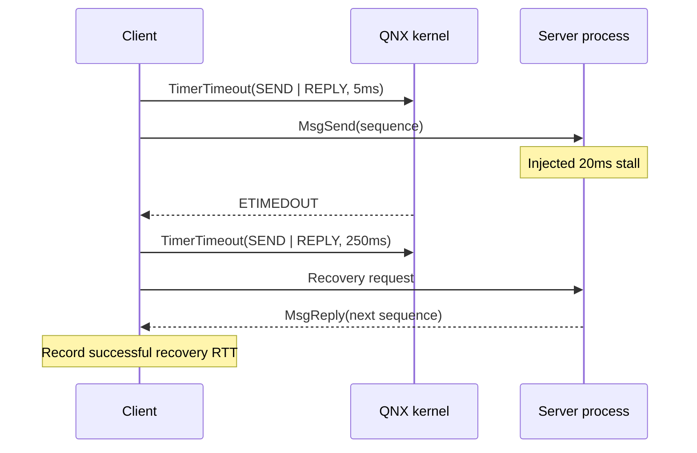
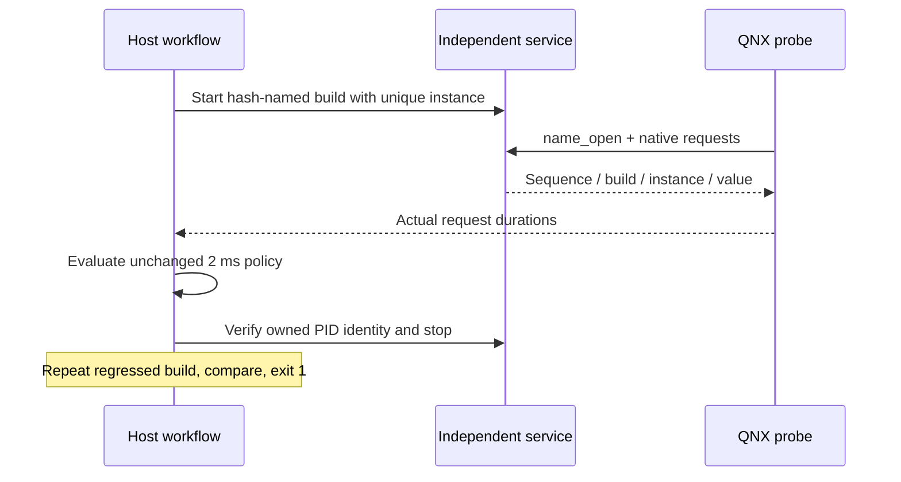

# Architecture and measurement contract

## Components and boundaries

| Component | Responsibility |
| --- | --- |
| `agent/main.c` | Bounded input parsing, scheduling, lifecycle, watchdog, buffered output |
| `agent/timing.c` | Absolute releases, busy work, wake lateness, response time |
| `agent/ipc.c` | Separate server process, native channels, kernel timeouts, recovery |
| `agent/service_probe.c`, `examples/telemetry-service/` | Independent named-channel application and actual request timings |
| `agent/load.c` | Same-priority CPU worker threads, bounded shutdown |
| `agent/system.c` | Verify idle thread names; obtain per-CPU idle execution clocks |
| `pulseproof/scenario.py` | Versioned scenario validation and numeric command arguments |
| `pulseproof/target.py` | VM lease discovery, pinned SSH, SFTP, environment identity |
| `pulseproof/analysis.py` | Evidence validation, distributions, policy gates, comparability |
| `pulseproof/runner.py` | Acquisition, provenance, atomic result publication |
| `pulseproof/application.py`, `locking.py`, `evidence.py` | Owned application lifecycle, acquisition lock, imported-evidence recomputation |
| `pulseproof/server.py`, `web/` | Loopback API, allowlisted execution, local visualization |

## Timer semantics

For sample `i`, release `r[i] = start + (i+1)*period`. `clock_nanosleep(CLOCK_MONOTONIC, TIMER_ABSTIME)` waits for that release. Wake lateness is `max(actual_wake-r[i],0)`. Response time is `completion-r[i]`, including work, injected stalls, and any release backlog. Releases are never silently skipped or shifted after an overrun. A completed response misses its deadline only when response time is **strictly greater** than its budget.

The clock is monotonic. Its reported resolution, QNX clock period, minimum observed clock-read pair, and hardware cycles-per-second are recorded separately. Nanosecond representation is not a claim of nanosecond scheduling accuracy. Minimum clock-read overhead is diagnostic and is not subtracted from measurements.

## IPC semantics

The internal server uses `ChannelCreate(0)` without `_NTO_CHF_UNBLOCK`, so a timed-out client can unblock without server acknowledgement. A stale reply may return `ESRCH`. The independent named service handles disconnect/unblock pulses and uses a separate 50 ms transport timeout for its completed-response regression. These are different channel contracts.

The agent forks a separate server before creating worker threads. The child creates a QNX channel and communicates its ID through a bounded pipe handshake. The parent attaches a side-channel connection. Twenty warmup exchanges are excluded. Each measured request carries a sequence checked against the reply.

Immediately before `MsgSend`, the client arms `TimerTimeout` for both SEND and REPLY states. A fault delays every configured nth server reply. After a timeout, the next exchange receives a 250 ms recovery budget, allowing it to wait for the delayed server. A successful next exchange is counted as recovery. This tests bounded timeout handling and service recovery from a stall; it does not claim process-crash restart or network partition tolerance.

Timeout duration is the time until the kernel returns an error, not the unobserved full service latency. Percentiles of **successful responses** exclude errored attempts but include successful recovery exchanges. All-attempt durations are retained separately. A timeout/error marks `deadline_unobserved=true`, `deadline_miss=false`. Unexpected errors always fail policy. Expected fault counts and minimum successful recoveries are independent gates, so a service that stops responding cannot pass by disappearing from the percentile population.

## Independent application boundary

The telemetry application is separate from the internal IPC benchmark. It registers a channel with `name_attach`; the probe uses `name_open`. Replies validate protocol, sequence, build, deterministic value and a per-launch 64-bit instance ID. Twenty warmups are excluded. Baseline and regressed builds differ by a 5 ms request-path delay; both use a 2 ms deadline and 50 ms transport timeout. This explicit protocol adapter does not instrument arbitrary processes.

The host uploads hash-named binaries, starts an owned service with a 45-second watchdog and verifies its exact executable identity before cleanup. Application source/binary hashes are captured. Comparison permits application build changes while requiring identical agent, workload, acceptance gates and environment.

## Scheduling and CPU observation

The main thread requests `SCHED_RR` at the configured priority and refuses to continue if scheduling setup fails. Workers inherit this scheduling context and generate approximately 8 ms busy / 2 ms sleep cycles. Actual load depends on guest scheduling. Main-process CPU time includes load threads but excludes the IPC child.

For guest-wide busy estimates, each assumed procnto idle TID is first verified to have the expected `idle_cpu_N` name. `ClockId(1, tid)` and `ClockTime` read those CPU-time clocks before and after measurement. With `N` CPUs and observation interval `D`, busy fraction is `1 - sum(idle_delta)/(N*D)`. Small sequential-read skew is tolerated up to 1%; unavailable or inconsistent observations are reported as unavailable. This is a guest CPU estimate, not host CPU utilization. No global clock period, CPU affinity, kernel instrumentation, or system security settings are changed.

## Evidence integrity and safety

Raw output is emitted after measured loops, reducing stdout observer effects. Every run requires metadata, contiguous samples with matching scenario parameters, and a completion footer. The analyzer rejects missing records, duplicate sequences/JSON keys, NaN, invalid booleans, wrong fault schedules, forged timeout flags, and inconsistent deadline fields.

The agent has numeric bounds, a 60-second watchdog, owned-child cleanup, and a bounded startup handshake. Invalid input exits before workload creation. The host uses argv subprocess execution and only validated numeric remote arguments. Remote uploads are restricted to simple names under `/data`. The local API binds to `127.0.0.1`, checks Host and Origin, requires a random anti-CSRF token, allows one experiment at a time, and never accepts arbitrary commands. Root is used only on the isolated development guest for required QNX scheduling/process-query abilities; production privilege separation is future work.

The binary hash and source manifest must match before deployment. Results retain raw/scenario hashes and sanitized host/VM identity. These provide reproducibility and corruption detection, not remote attestation. Imported files can assert their own source label; only the `run` acquisition path verifies the QNX target and pinned transport.

Baseline comparison requires matching configuration, clock, scheduler, target architecture/kernel release, CPU count, clock period, agent version/binary, and host/VM identity. It rejects incompatible runs. A candidate's own failed policy also fails comparison. Recorded environmental identity does not remove ambient host contention or provide statistical significance; use repeated controlled runs for decisions.

## References

- [Absolute clock_nanosleep](https://qnx.com/developers/docs/8.0/com.qnx.doc.neutrino.lib_ref/topic/c/clock_nanosleep.html)
- [TimerTimeout kernel states](https://qnx.com/developers/docs/8.0/com.qnx.doc.neutrino.lib_ref/topic/t/timertimeout.html)
- [Native channel semantics](https://qnx.com/developers/docs/8.0/com.qnx.doc.neutrino.lib_ref/topic/c/channelcreate.html)
- [ClockId CPU-time clocks](https://www.qnx.com/developers/docs/8.0/com.qnx.doc.neutrino.lib_ref/topic/c/clockid.html)
